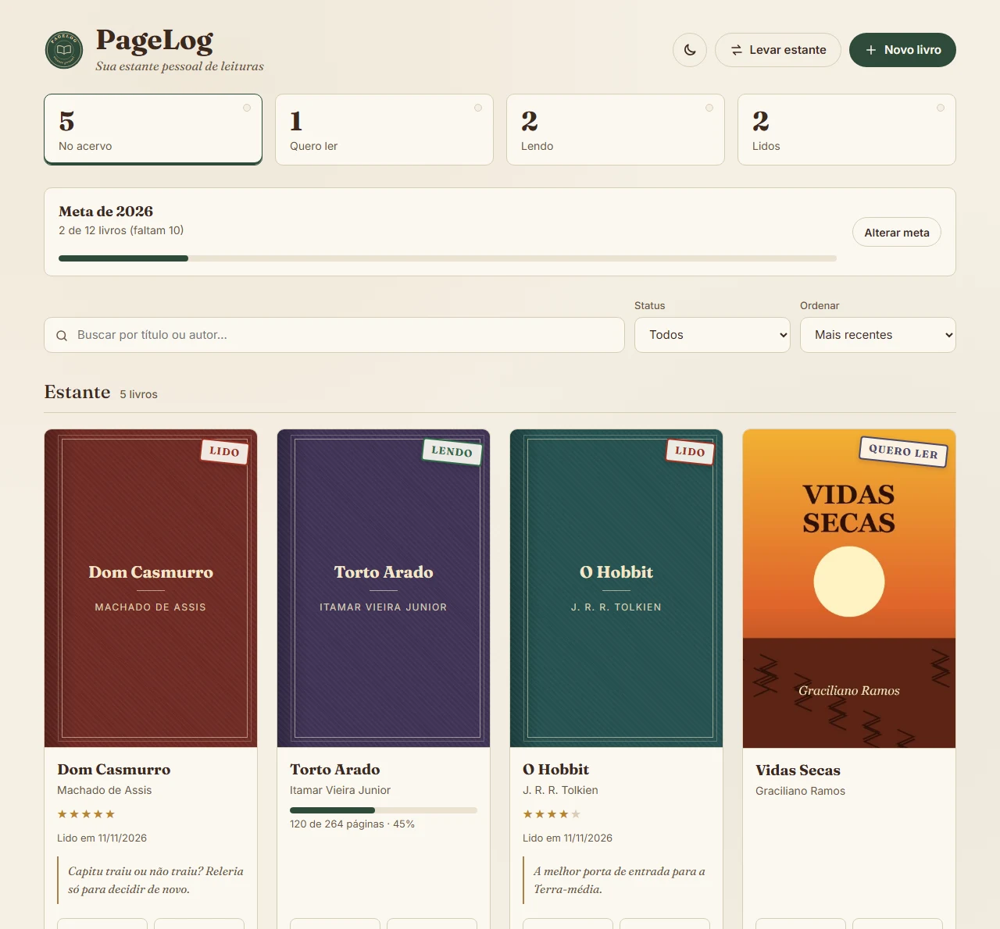
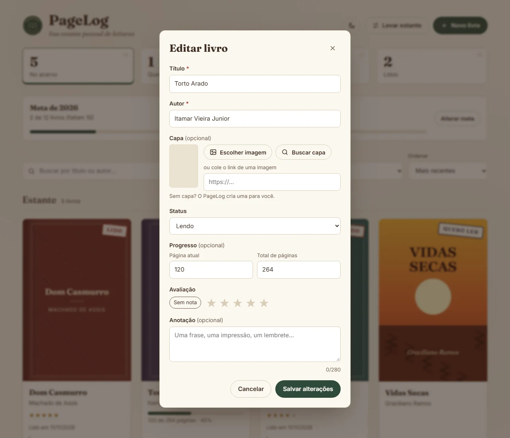
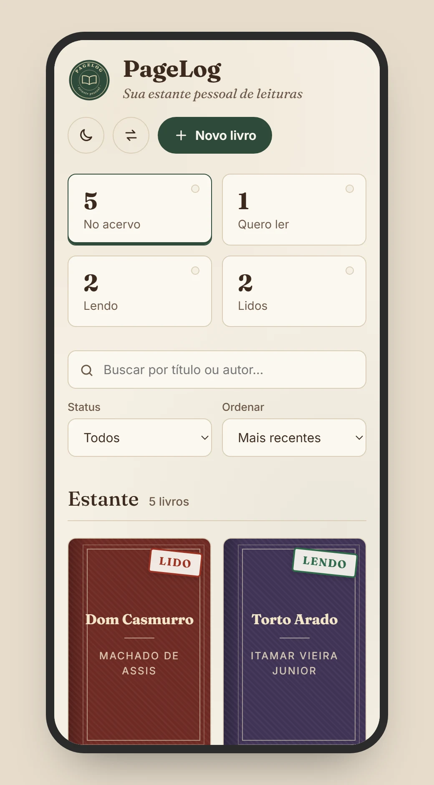

<div align="center">


# PageLog

**Sua estante pessoal de leituras.**

Um gerenciador de leituras para catalogar livros, acompanhar o que você está lendo e guardar suas notas e impressões.<br>
Feito com **HTML, CSS e JavaScript puro**, sem frameworks, sem bibliotecas e sem etapa de build.

[Recursos](#-recursos) · [Como rodar](#-como-rodar) · [Decisões técnicas](#-decisões-técnicas) · [Uso de IA](#-uso-de-ia) · [Autor](#-autor)


</div>

---

## 📸 Capturas de tela

<p align="center">
  
  <br><em>A estante: fichas de resumo que também filtram, busca, ordenação e capas com carimbo de status</em>
</p>

<p align="center">
  
  <br><em>Formulário de cadastro e edição, com validação e nota em estrelas acessível pelo teclado</em>
</p>

<p align="center">
  
  <br><em>Versão para celular</em>
</p>

---

## 📖 Sobre o projeto

O PageLog começou como o **Desafio Fase 2 da Pós-graduação Dev Start** (com apoio educacional da Rocketseat), o projeto de conclusão daquela etapa do curso: um CRUD de livros com `localStorage`.

Depois de entregue, voltei a ele com outro olhar. Corrigi falhas que eu não tinha percebido (entre elas uma brecha de segurança), refiz a acessibilidade e dei ao projeto uma identidade própria: a de um **sebo**, com papel envelhecido, tinta marrom, capas de encadernação em tecido e o carimbo de biblioteca que marca cada livro como *Lido*, *Lendo* ou *Quero ler*.

A ideia é que ele seja ao mesmo tempo útil e uma vitrine de fundamentos: DOM, eventos, estado, acessibilidade e CSS bem organizado, sem esconder nada atrás de um framework.

---

## ✨ Recursos

| Recurso | O que faz |
|---|---|
| **Cadastro completo** | Adicionar, editar e excluir livros com título, autor, capa, status, nota e anotação |
| **Capa automática** | Sem imagem, ou se o link da capa quebrar, o PageLog gera uma capa com título, autor e uma cor própria para cada livro |
| **Carimbos de status** | *Quero ler*, *Lendo* e *Lido*, no estilo dos carimbos de biblioteca |
| **Fichas de resumo** | Contam os livros por status e, ao clicar, filtram a estante |
| **Busca sem acento** | Encontra por título ou autor ignorando acentos e maiúsculas ("codigo" acha "Código Limpo") |
| **Ordenação** | Mais recentes, título, autor ou maior nota |
| **Nota em estrelas** | De 1 a 5 ou "sem nota", com prévia ao passar o mouse e uso pelo teclado |
| **Excluir com "Desfazer"** | O livro removido pode voltar por alguns segundos, sem precisar de uma janela de confirmação |
| **Exemplos com um clique** | Na estante vazia, "Ver exemplos" preenche o app para quem quer só conhecer |
| **Dados no navegador** | Tudo fica salvo no `localStorage`: nada é enviado para servidor nenhum |

---

## 🚀 Como rodar

Não há dependências nem etapa de build: o código do repositório é o código que roda no navegador.

```bash
git clone https://github.com/gustavomenacho/Gerenciador-de-Leituras.git
cd Gerenciador-de-Leituras
```

Depois, abra o `index.html` no navegador (duplo clique funciona). Se preferir um servidor local, use a extensão **Live Server** do VS Code ou:

```bash
npx serve .
```

---

## 🗂️ Estrutura

```
index.html           estrutura da página, ícones SVG e o formulário (<dialog>)
style.css            identidade visual (tokens de cor no :root), layout e responsividade
script.js            estado, armazenamento, renderização e eventos
assets/
  pagelog.svg        selo/logo
  favicon.svg        ícone da aba
docs/capturas/       imagens deste README
```

---

## 🧠 Decisões técnicas

**Segurança: nada de `innerHTML` com dados do usuário.** Na primeira versão, os cards eram montados com `innerHTML`, e um título como `` virava código executado na página (XSS). Agora cada parte do card é criada com `createElement` e preenchida com `textContent`, que trata tudo como texto. O link da capa também só é aceito se começar com `http://` ou `https://`.

**Uma fonte de verdade.** Os livros vivem num array de objetos, e uma única função, `render()`, desenha a tela inteira a partir dele: grade, contadores e estados vazios. Assim, a interface nunca fica fora de sincronia com os dados (um bug da primeira versão: os contadores paravam de atualizar quando a busca não encontrava nada).

**Identificador único em vez de posição.** Cada livro tem um `id` (`crypto.randomUUID()`). Usar a posição no array como identificador quebra fácil quando a lista está filtrada ou ordenada. Dados salvos pela versão antiga, sem `id`, são convertidos automaticamente ao carregar.

**Armazenamento à prova de falhas.** A leitura do `localStorage` fica dentro de um `try/catch`. Se o dado estiver corrompido ou o navegador bloquear o armazenamento, o app começa vazio em vez de quebrar.

**`<dialog>` nativo para o formulário.** O elemento `<dialog>` com `showModal()` já entrega, de graça, o que antes exigiria código manual: foco preso dentro do modal, fechamento com Esc, fundo inerte e retorno do foco ao botão que o abriu.

**Delegação de eventos.** Um único ouvinte na grade atende os botões Editar e Excluir de todos os cards, inclusive os criados depois.

**Acessibilidade.**
- HTML semântico: lista de livros em `<ul>`, títulos hierárquicos, `<fieldset>` e `<legend>` na nota.
- A nota em estrelas é um grupo de botões de opção (`radio`): funciona com as setas do teclado e o leitor de tela anuncia "3 estrelas".
- Rótulos em todos os campos, mensagens de erro ligadas ao campo (`aria-describedby`, `aria-invalid`) e avisos anunciados por `role="status"`.
- Foco visível em todos os elementos interativos e link "Pular para a estante".
- Respeita `prefers-reduced-motion`.

**CSS com tokens.** Todas as cores e fontes ficam em variáveis no `:root` (`--paper`, `--ink`, `--green`…). A textura de papel e o tecido das capas são feitos só com gradientes, sem nenhuma imagem extra, e os ícones são SVG embutidos no HTML (`<symbol>` + `<use>`), no lugar dos PNGs da primeira versão.

**Responsivo.** Grade com `auto-fill` e `minmax()`, fichas em duas colunas e filtros reorganizados no celular, sem rolagem horizontal.

---

## 🤖 Uso de IA

A primeira versão foi feita por mim durante o curso. Nesta revisão, usei o **Claude (Anthropic)** como apoio: para revisar o código, apontar falhas (como o XSS e os problemas de acessibilidade), propor a identidade visual, explicar cada mudança e gerar as capturas de tela deste README. As escolhas de identidade, nome e escopo foram minhas, e todo o código foi revisado e testado por mim no navegador.

---

## 👤 Autor

**Gustavo Menacho**: advogado em transição para o desenvolvimento front-end.

[](https://www.linkedin.com/in/gustavomenacho/)
[](https://github.com/gustavomenacho)
[](mailto:menacho1996@gmail.com)
