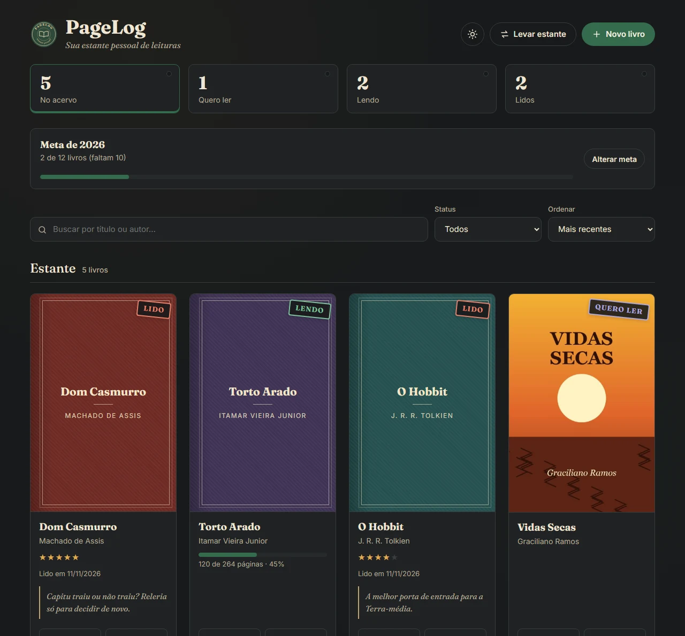
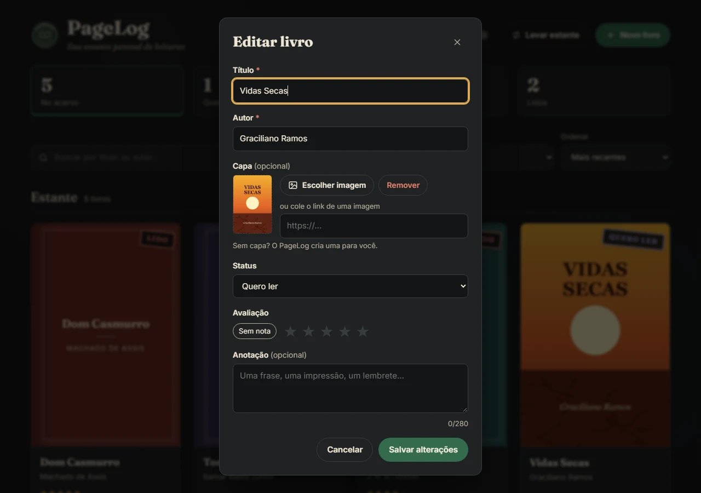
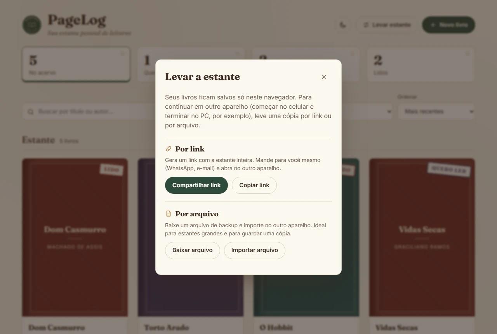
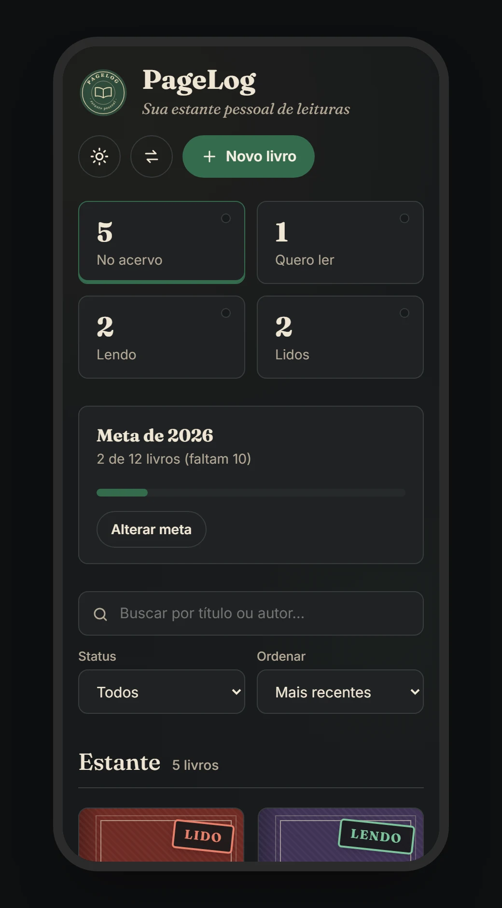

<div align="center">


# PageLog

**Sua estante pessoal de leituras.**

Gerenciador de leituras para cadastrar livros, acompanhar o que estou lendo e guardar minhas notas.<br>
Feito com **HTML, CSS e JavaScript puro**, sem frameworks e sem bibliotecas.

[**🌐 Ver o site no ar**](https://pagelog-leituras.netlify.app) · [Funcionalidades](#-funcionalidades) · [Como rodar](#-como-rodar) · [Lighthouse](#-lighthouse) · [O que aprendi](#-o-que-aprendi) · [Autor](#-autor)


</div>

---

## 📸 Telas

<p align="center">
  
  <br><em>Estante com meta do ano, progresso de leitura e uma capa enviada do aparelho</em>
</p>

<p align="center">
  
  <br><em>Tema escuro</em>
</p>

<p align="center">
  
  
  <br><em>Cadastro e edição</em>
</p>

<p align="center">
  
  <br><em>Levar a estante para outro aparelho</em>
</p>

<p align="center">
  
  
  <br><em>No celular</em>
</p>

---

## 📖 Sobre

Esse projeto começou como o **Desafio Fase 2 da Pós-graduação Dev Start** (com apoio da Rocketseat): um CRUD de livros salvando no `localStorage`.

Depois de entregar, voltei nele para melhorar. Corrigi bugs que tinham passado (inclusive uma falha de segurança), melhorei a acessibilidade e dei uma cara própria para ele: a de um **sebo**, com papel envelhecido, capas de tecido e carimbos de biblioteca marcando cada livro como *Lido*, *Lendo* ou *Quero ler*.

---

## ✨ Funcionalidades

- Cadastrar, editar e excluir livros (título, autor, capa, status, nota e anotação)
- **Progresso de leitura**: página atual e total, com barra de progresso nos livros que estou lendo
- **Meta do ano**: quantos livros quero ler e quantos já terminei (conta pela data em que terminei)
- Capa com **imagem do próprio aparelho** (galeria ou câmera no celular) ou por link, com prévia no formulário
- **Buscar capa** pela [Open Library](https://openlibrary.org/developers/api): mostra algumas capas para escolher e já completa autor e número de páginas
- Capa gerada automaticamente quando o livro não tem imagem ou o link da capa quebra
- Totais por status no topo, que também funcionam como filtro
- Busca por título ou autor ignorando acentos ("codigo" encontra "Código Limpo")
- Ordenar por mais recentes, título, autor ou nota
- Nota de 1 a 5 estrelas, funcionando também pelo teclado
- Excluir com opção de **desfazer**
- **Levar a estante para outro aparelho** (começar no celular e continuar no PC) por link ou por arquivo de backup
- Tema claro e escuro (segue o sistema, mas dá para trocar no botão)
- **Instalável como app** no celular e no PC, e funciona **sem internet**
- Botão "Ver exemplos" para quem quer só conhecer o app
- Tudo salvo no navegador, sem servidor

---

## 🚀 Como rodar

O site está no ar em **[pagelog-leituras.netlify.app](https://pagelog-leituras.netlify.app)** (o Netlify publica de novo a cada push na `main`).

Para rodar localmente não precisa instalar nenhuma dependência, mas precisa de um servidor local, porque o JavaScript usa módulos (`import`/`export`) e o navegador não carrega módulos abrindo o arquivo direto (`file://`):

```bash
git clone https://github.com/gustavomenacho/Gerenciador-de-Leituras.git
cd Gerenciador-de-Leituras
npx serve .
```

Ou use a extensão **Live Server** do VS Code. Com Python também funciona: `python -m http.server`.

**Instalar no celular:** abra o site no Chrome (Android) e toque em "Instalar o PageLog" no rodapé ou em "Adicionar à tela inicial" no menu. No iPhone, use Compartilhar → "Adicionar à Tela de Início".

---

## 📊 Lighthouse

Medido no site publicado com o [PageSpeed Insights](https://pagespeed.web.dev/) em novembro de 2026:

| | Desempenho | Acessibilidade | Boas práticas | SEO |
|---|:---:|:---:|:---:|:---:|
| **Celular** | 98 | 100 | 100 | 100 |
| **Computador** | 97 | 100 | 100 | 100 |

---

## 🗂️ Arquivos

```
index.html             estrutura da página e janelas (dialog)
style.css              estilos, cores do tema claro e escuro, responsivo
manifest.webmanifest   dados do app instalável (nome, ícones, cores)
sw.js                  service worker: guarda os arquivos para funcionar offline
js/
  main.js              liga os eventos e inicia a página
  estado.js            variáveis compartilhadas (lista de livros etc.)
  constantes.js        valores fixos e livros de exemplo
  elementos.js         referências aos elementos do HTML
  utils.js             funções pequenas usadas em vários lugares
  dados.js             formato do livro, salvar e carregar do localStorage
  tela.js              desenha os cards, totais e filtros
  formulario.js        cadastro/edição, estrelas e capa no formulário
  capas.js             capas do aparelho no IndexedDB
  openlibrary.js       busca de capas na Open Library
  meta.js              meta de leitura do ano
  acoes.js             excluir, desfazer, exemplos, avisos
  tema.js              tema claro/escuro
  transferir.js        levar a estante por link ou arquivo
  pwa.js               registra o service worker e o botão de instalar
fonts/                 Fraunces e Inter (licença OFL)
assets/                logo, favicon e ícones do app
docs/capturas/         imagens do README
```

---

## 🧠 O que aprendi

**XSS e por que não usar `innerHTML` com dado do usuário.** Na primeira versão eu montava os cards com `innerHTML`. Descobri que se alguém cadastrasse um livro com o título ``, aquilo virava código rodando na página. Troquei para `createElement` + `textContent`, que trata tudo como texto. Também passei a aceitar só links de capa com `http://` ou `https://`.

**Uma função para desenhar a tela.** Os livros ficam num array e a função `render()` redesenha tudo a partir dele (cards, totais e mensagens de lista vazia). Antes os totais paravam de atualizar quando a busca não achava nada, porque a função saía antes de chegar nessa parte.

**Usar id em vez da posição no array.** Antes eu identificava o livro pelo índice, o que dava problema com a lista filtrada. Agora cada livro tem um `id` gerado com `crypto.randomUUID()`. Os livros salvos na versão antiga ganham um id quando a página carrega, então ninguém perde nada.

**`<dialog>`.** Usando o `<dialog>` com `showModal()` o navegador já cuida de várias coisas: fechar com Esc, prender o foco dentro da janela e devolver o foco para o botão que abriu.

**Acessibilidade.** As estrelas da nota são `radio` escondidos com o `label` virando a estrela, então dá para escolher com as setas do teclado. Também coloquei `label` em todos os campos, mensagens de erro com `aria-describedby`, foco visível e `prefers-reduced-motion`.

**Tema escuro com variáveis CSS.** Todas as cores estão em variáveis no `:root`. O tema escuro só troca o valor delas em `:root[data-theme="dark"]`. Um script pequeno no `<head>` aplica o tema antes da página aparecer, para não piscar branco.

**Capas do aparelho com IndexedDB.** Antes a capa só podia ser um link. Para aceitar uma foto do celular eu tinha dois problemas: o `localStorage` só guarda texto e tem limite de uns 5 MB, e uma foto de celular sozinha já passa disso. A solução foi:
- **diminuir a imagem antes de salvar:** desenho a foto num `<canvas>` com no máximo 400×600 px e exporto em JPEG (`canvas.toBlob`). Uma foto de 5 MB vira uns 15 KB;
- **guardar no IndexedDB**, o banco de dados do navegador que aceita arquivos (`Blob`) e tem muito mais espaço. A chave é o `id` do livro, e no `localStorage` o livro só guarda `localCover: true`;
- **mostrar** com `URL.createObjectURL()`, que cria um endereço temporário para o `` usar a imagem salva.

Quando a página abre, ela carrega as capas e apaga as que sobraram de livros excluídos. Não apago na hora de excluir porque aí o "Desfazer" perderia a capa.

**Progresso e meta.** Cada livro guarda `pagesRead`, `pagesTotal` e `finishedAt`. A barra usa o elemento `<progress>`, que já é acessível. Quando marco um livro como "Lido", o formulário preenche a data de hoje e completa as páginas. A meta conta os livros com `finishedAt` no ano atual. Para pegar a data de hoje usei `getFullYear/getMonth/getDate` em vez de `toISOString()`, porque o `toISOString` converte para o horário de Londres e à noite dava o dia seguinte.

**Consumir uma API pública (Open Library).** O botão "Buscar capa" usa `fetch` na API de busca da Open Library com `URLSearchParams` e mostra só os resultados que têm capa. Coloquei um tempo limite com `AbortController` (se a API demorar mais de 8 segundos, cancela) e mensagens para "sem resultado" e "sem internet". A busca só acontece quando clico no botão, nunca enquanto digito.

**Separar em módulos.** O `script.js` tinha passado de 1.400 linhas. Dividi em arquivos por assunto com `import`/`export`. Uma coisa que aprendi: um módulo não consegue mudar uma variável `let` de outro módulo, então as variáveis compartilhadas (como a lista de livros) ficam num objeto `state` em `estado.js`.

**App instalável e offline (PWA).** O `manifest.webmanifest` diz ao navegador o nome, os ícones e as cores do app, e isso permite instalar. O `sw.js` é um service worker: na instalação ele guarda os arquivos do site no aparelho, e depois intercepta os pedidos. Usei "rede primeiro": com internet pega a versão nova; sem internet usa a cópia guardada. Testei derrubando o servidor e o site continuou abrindo. As capas da Open Library ficam num cache separado para aparecerem offline também.

**Fontes no próprio site.** Antes as fontes vinham do Google Fonts, que é um pedido a outro servidor antes de mostrar o texto. Baixei só os arquivos `.woff2` do alfabeto latino (são fontes variáveis, um arquivo cobre vários pesos) e uso `@font-face` com `preload`. Fica mais rápido e funciona offline.

**Um bug com `hidden`.** Botões com `hidden` continuavam aparecendo. O motivo: a classe `.btn` tem `display: inline-flex`, e isso ganha da regra padrão do navegador para `[hidden]`. Resolvi com `[hidden] { display: none !important; }`.

**Levar a estante sem servidor.** Como o `localStorage` é de cada navegador, os livros do celular não aparecem no PC. Para resolver sem precisar de login e banco de dados:
- **Link:** transformo a estante em JSON, comprimo com `CompressionStream`, converto para base64 e coloco depois do `#` no link. O que vem depois do `#` não vai para o servidor, então os dados passam direto de um navegador para o outro.
- **Arquivo:** o mesmo JSON, baixado como `.json` e importado com `<input type="file">`. O arquivo também leva as capas do aparelho (convertidas em texto com `FileReader`); o link não leva, porque ficaria grande demais.

Na hora de importar dá para **juntar** ou **substituir**. Para juntar sem duplicar, comparo os livros pelo id ou por título + autor, e fica a versão que foi editada por último (cada livro guarda `updatedAt`). Como o arquivo pode vir de qualquer lugar, todo livro importado passa pela mesma função que limpa e valida os dados do formulário.

---

## 👤 Autor

**Gustavo Menacho**, advogado em transição para o desenvolvimento front-end.

[](https://www.linkedin.com/in/gustavomenacho/)
[](https://github.com/gustavomenacho)
[](mailto:menacho1996@gmail.com)
